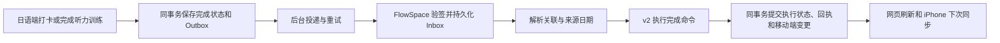

# 日语学习任务与 FlowSpace 自动完成联动方案

日期：2026-11-19
状态：第一版完成事件闭环已实现，尚未部署
范围：`all_note` 的 v2 任务域与相邻的 `japanese-learning-app`

实施说明：已实现账号配对、单项任务关联、事务 outbox/inbox、签名投递与重试、当天 occurrence 完成、移动同步变更和两端设置界面。实际使用、迁移要求和首版边界见[联动指南](../../japanese-learning-integration.md)，真实跨仓库 HTTP 测试见[测试说明](../../japanese-learning-integration-testing.md)。下文保留设计；历史重新映射、自动导入、时段聚合与自动回写撤销留待后续。

## 1. 推荐方案

**日语项目负责判断学习任务完成，FlowSpace 负责安排和展示；两边通过服务端事件，把来源任务关联到 FlowSpace 的某次执行。**

第一版实现“连接账号 → 关联已有任务 → 日语任务完成 → FlowSpace 对应执行实例完成”。保留两个独立服务和数据库，采用数据库 outbox、HTTP 投递和接收回执，不增加消息中间件。

第一版只向 FlowSpace 传播完成结果。FlowSpace 中手动完成不反向产生学习记录；日语端撤销也不自动重新打开已完成的 FlowSpace 实例，界面会展示状态差异。撤销事件仍用于版本控制，防止迟到的旧事件覆盖更新状态。

后续可以增加学习计划批量导入、整时段聚合完成，以及各练习模块按学习量自动打卡。这些能力与跨项目传递完成结果分别实施。

## 2. 已核对的项目基础

以下来自本次本地源码检查；两个工作区均有其他未提交修改，未启动服务或核实线上状态。

| 项目 | 当前事实 | 对设计的影响 |
| --- | --- | --- |
| 日语学习 | `studyplan` 有稳定的 `slot_id`、`task_id`，按计划时区计算当天任务 | 直接使用业务身份，不匹配任务标题 |
| 日语学习 | 完成表唯一键为 `(user_id, study_date, slot_id, task_id)` | 可以明确关联某一天、某时段的任务 |
| 日语学习 | 手动打卡支持完成与撤销；完整听力训练在自身 SQL 事务内自动打卡 | 两处写入统一产生事件 |
| 日语学习 | 其他练习统计与学习计划打卡尚未完全统一 | 不能承诺“做任意一次练习就自动完成计划” |
| 日语学习 | `/daily-plan` 是动态统计，整体完成按总量比较 | 首期不用它判定整天完成，防止某模块超额抵消其他模块未完成 |
| FlowSpace | v2 区分 Task、Schedule、Occurrence；重复执行 key 为本地日期 | 自动完成当天 Occurrence，不结束整项重复 Task |
| FlowSpace | 命令校验 runtime epoch、三类 revision、完成条件，并发布 mobile-v2 changes | 接入现有领域命令和事务边界 |
| 两边 | 暂无适用于此联动的通用账号连接及 webhook 鉴权 | 新增专用连接凭据，不复用浏览器会话 |

主要源码落点，日语路径相对相邻仓库，FlowSpace 路径相对本仓库：

- 日语：`internal/module/studyplan/slots.go:12`、`tasks.go:28`、`tasks.go:122`、`handler.go:103`。
- 日语：`internal/data/migrations/postgres/schema/017_study_plan_tasks.sql:1`。
- 日语：`internal/data/postgres/listening_store.go:556`，同事务打卡位于 `:619`。
- FlowSpace：`backend/internal/taskapp/facade.go:747`、`backend/internal/taskdomain/occurrence_service.go:102`。
- FlowSpace：`backend/internal/taskdomain/generator.go:20`、`occurrence_state.go:110`。
- FlowSpace：`backend/internal/storage/tenant.go:61`、`backend/internal/mobilev2command/sql_ledger.go:123`。

## 3. 用户使用方式

1. 在 FlowSpace 工作区设置中选择“连接日语学习”，生成短时、一次性的配对码。
2. 在已登录的日语项目设置中输入配对码。两个后端交换来源账号身份与当前计划目录，连接到明确的 FlowSpace 工作区。
3. 在 FlowSpace 任务详情的“自动完成来源”中选择：日语账号 → 当前计划 → 时段 → 学习任务。预览映射日期，保存关联。
4. 任务卡保留“开始学习”链接，进入日语项目对应页面。第一版链接负责导航，学习页按其现有登录流程授权。
5. 日语端任务完成后，FlowSpace 对应日期实例自动勾选，并显示“由日语学习完成”、来源日期和处理结果。短暂离线时显示待同步，恢复后补发。

例如，把来源 `evening / listening` 关联到 FlowSpace 的“晚间听力练习”重复任务。日语端完成 2026-11-19 的完整听力训练后，仅完成 FlowSpace 中 `occurrence_key=2026-11-19` 的那次执行；11 月 20 日的实例保持原状态。

首期关联已有任务，不自动创建同名任务。后续“导入学习计划”先展示创建/复用预览，再按相同绑定模型生成任务，避免重复维护两套计划。

## 4. 完成依据和映射粒度

### 4.1 首期：单项学习任务

**以日语端 `study_plan_task_completions` 对应的业务状态为权威。** 手动勾选和完整听力训练都可触发；播放音频、进入页面、提交尚未完成的训练不能触发。

单词、语法、口语、写作等首期沿用计划中的手动打卡。后续由各模块在学习记录提交成功后，按明确数量/材料/评分规则自动更新同一个打卡服务，再复用事件链路。数量与质量标准仍由日语项目定义。

第一版在同一连接内，每个来源任务模板只绑定一个目标重复任务；同一工作区内，目标不接受多个独立来源绑定，避免隐含“任意一个完成”或“全部完成”的歧义。

### 4.2 后续：按时段或整天聚合

如果 FlowSpace 希望只显示“午间学习 / 傍晚学习 / 晚间学习”三个任务，可增加 `slot_all` 聚合：当天该时段实际安排的所有学习任务均完成，才完成对应实例。整天聚合采用同样的逐项判断。

聚合必须使用当天的任务成员快照，过滤不属于当天的任务；空集合不视为完成。计划中途修改成员时，需要明确版本与生效日期，不能因删掉未完成项而静默补全整个时段。首期不开放聚合模式。

## 5. 身份、日期和改期

来源任务模板身份：

`source_instance_id + source_user_id + plan_id + slot_id + task_id`

来源执行身份再增加 `study_date`。目标模板身份为 `workspace_id + task_id`，目标执行身份为 `workspace_id + occurrence_id`。

- `plan_id` 为新增的不可变计划代际 ID。普通编辑只增加 `plan_revision`；删除重建计划产生新 `plan_id`。来源部署实例 ID 也应持久化，测试与生产不同。
- 当前日语项目只有用户主键和 revision。仅用 revision 当计划身份会导致每次改时间都失联；仅用用户和 task_id 则会把旧计划延迟事件发给新计划。
- 首期只允许关联有日期的重复任务，来源计划时区与目标 Schedule 时区必须一致。实例按来源 `study_date` 查找原始 `occurrence_key`，不能按 webhook 到达日期或当前 `planned_date` 查找。
- 例如 11 月 19 日完成、11 月 20 日才补发，仍对应 11 月 19 日实例。日界线沿用日语计划当前规则；不会默认把午夜后的训练算作前一天。
- 首次解析后固定保存来源执行 → `occurrence_id`。单次改期保留原实例身份；如果旧实例被删除或从该次起重排生成替代实例，必须重新确认映射，不猜测替代对象。
- 绑定保存生效日期区间、源计划修订快照和目标 schedule revision。来源任务含义、学习日、时区或目标重复规则发生变化时暂停受影响关联，展示差异后确认恢复；只改标题不改变身份。
- 绑定修改创建不可变的新 `binding_version`，按来源学习日期划分互不重叠的生效区间，不原地改写旧路由。重新关联默认从下一个学习日起生效。首次收件按学习日期冻结绑定版本；尚无绑定的事件保留 unbound，补关联后的历史重放必须预览确认。收件后修改关联不能把待处理旧事件转发到新目标。
- 默认从关联生效日开始。不在首次连接时自动完成所有历史任务；历史补同步需选定日期范围并预览。

## 6. 事件链路与事务



### 6.1 日语端

把手动打卡和 `CompleteListeningTask` 抽到同一个完成状态写服务，支持传入现有 `*sql.Tx`。实际状态变化时，在同一 PostgreSQL 事务里保存完成状态、单实例递增版本和 outbox 事件。重复勾选或重复完成同一训练不重复产生事件。

手动打卡当前直接用 `h.db.ExecContext`，需要改成事务；听力路径已在训练事务中，必须复用该事务，不能另开事务。HTTP 调用在事务提交之后由后台 worker 执行，不阻塞学习操作等待 FlowSpace。

新增状态记录保留撤销后的版本、完成时间及原因。现有完成表可以继续用于当天展示，但两者通过同一个写服务更新；不能删除完成行时连同版本一起丢掉。补偿查询也应读取该状态服务。新增表不随计划删除级联清空未投递事件或版本墓碑。

后台 worker 使用标准库 HTTP 客户端，持久化尝试次数、租约、下次重试时间与错误码。网络失败/429/5xx 退避重试；签名错误、连接撤销等配置错误暂停并提示。每次网络重试都使用新的签名时间戳和 nonce，业务 `event_id` 及其 payload 保持不变。

### 6.2 FlowSpace 端

接收端先校验身份、签名和连接，在 tenant 事务中保存 inbox 与匹配的不可变绑定版本后返回 `202 accepted`。并发修改绑定与收件需要共用锁或 revision 校验。这只表示可靠收件，不表示任务已完成。后台处理结果可从事件状态接口及工作区同步记录查看。

处理 worker 每次重新解析工作区 runtime 与 epoch。在一个 fenced tenant 事务中完成：锁定来源实例和 inbox → 检查版本及绑定 → 读取目标当前版本 → 执行已有完成规则 → 写来源快照、执行映射和最终回执。收件与处理共用来源实例的版本协调规则；处理前优先读取已收件的最高 state_revision，较旧事件标记 stale。任务日志与 mobile-v2 change batch 必须与领域写入同事务提交。

**不能在现有 Facade 调用前后分别写“已处理”回执。** 当前 Facade 自行生成 command ID 并进入写事务，直接外包一层事务会留下崩溃窗口或嵌套事务。需要参照 mobile-v2 的 transaction runner，扩展窄的集成事务能力，复用 occurrence 领域逻辑及 tenant writer；不直接 UPDATE occurrence 状态。

## 7. 事件与接口提案

以下均为新增协议，当前未实现。

```json
{
  "schema_version": 1,
  "event_id": "evt_unique_id",
  "type": "study_task.state_changed.v1",
  "source_instance_id": "japanese-production",
  "source_user_id": "123",
  "plan_id": "plan_generation_id",
  "plan_revision": 7,
  "catalog_revision": 12,
  "slot_id": "evening",
  "task_id": "listening",
  "study_date": "2026-11-19",
  "timezone": "Asia/Shanghai",
  "state_revision": 1,
  "completed": true,
  "occurred_at": "2026-11-19T11:05:00Z",
  "reason": "listening_training"
}
```

不携带目标 workspace/task ID 作为可执行指令；目标由连接和已保存绑定决定。事件只包含完成所需元数据，不传录音、答案正文或浏览器 JWT。`occurred_at` 保留学习实际完成时间，FlowSpace 日志记录实际命令执行时间，二者分别展示。

| 接口 | 身份 | 用途 |
| --- | --- | --- |
| `POST /api/integrations/japanese/pairing-codes` | FlowSpace 当前工作区管理员会话 | 创建一次性配对码 |
| `POST /api/integrations/japanese/pair` | 短时配对码 | 一次性绑定来源账号，返回专用连接凭据 |
| `PUT /api/integrations/japanese/catalog` | 集成签名 | 来源提交当前计划、修订与可关联任务目录 |
| `POST /api/integrations/japanese/events` | 集成签名 | 可靠收件，首次返回 202 |
| `GET /api/integrations/japanese/events/:eventID` | 同一连接的集成签名 | 区分已送达、处理中、已应用或冲突 |
| `/api/integrations/japanese/bindings` | FlowSpace 当前工作区授权会话 | 创建、查看、暂停、修改绑定 |
| `/api/integrations/japanese/events/:eventID/retry` | FlowSpace 当前工作区授权会话 | 修复关联/完成条件后显式重试 |

`catalog` 在配对及计划保存/删除后由日语端后台同步，关联变更只由 FlowSpace 已授权用户确认。目录新增 `(source_instance_id, source_user_id)` 级别的递增 `catalog_revision`，在计划删除/重建后也不归零，持久化在计划表之外；删除发送明确 tombstone。目录快照、修订推进与 outbox 入队同事务，接收端只应用更高版本，同版本不同摘要报错，避免旧目录或迟到删除覆盖新计划。

完成事件带其产生时的 `catalog_revision`，接收端尚未取得相应目录时等待同步。目录变更可能影响旧绑定时，冻结旧路由并暂停处理，不能迁移到新计划。来源计划管理事件也须可持久重试，不能只由浏览器在保存成功后额外发一个请求。

## 8. 幂等、乱序与冲突

去重分两层：`(connection_id, event_id)` 防止重复 HTTP 投递；来源执行身份与 `state_revision` 防止同一任务不同事件乱序。相同 event ID、不同 payload hash 返回冲突并暂停该事件。

| 情况 | 默认处理 |
| --- | --- |
| 正常未完成实例，来源 completed=true | 执行 complete，保存来源与目标执行关联 |
| 同一事件再次投递 | 返回原回执，不再执行 |
| 同一来源实例的较旧版本 | 标记 stale，不修改目标 |
| 来源 completed=false | 更新来源版本；尚未执行的旧完成事件作废；已完成的目标保持并标记差异 |
| 目标已经 done | 返回 already_done，不重复完成日志，不宣称是集成完成的 |
| 目标被手动重新打开 | 原事件/同版本补偿不再完成；来源再次发生未完成→完成的新转换时才可再次同步 |
| 目标 blocked/skipped/cancelled、任务暂停/归档 | 保留状态，记录需处理；集成层补充生命周期准入校验 |
| 目标有未完成 completion requirements | 保留领域限制，不代勾要求；修复后可显式重试 |
| 目标实例未生成 | 使用正常生成服务在来源日期的有限窗口物化，再定位；仍无合法实例则冲突 |
| 目标删除、映射过期、计划代际变化 | 暂停并提示，不新建或完成同名任务 |
| revision 并发冲突 | 重新读取并有限重试；不绕过版本检查 |
| runtime fenced/epoch 变化 | 暂停本次写入，重新解析运行时后重试 |

`received/retry_wait/processing` 为可恢复状态，`applied/already_done/stale` 为成功终态，`needs_attention` 为业务冲突。显式重试可在锁定同一 inbox 记录后恢复处理，但必须重新校验来源当前版本和冻结绑定的有效性；不能套用当前最新关联。确需把未处理事件转到新目标时，单独预览并记录重路由操作。已成功处理的回执不能用“重试”重复执行。

第一版撤销策略的可见限制：如果完成事件已经应用，之后来源撤销，FlowSpace 保留已完成并提示差异；如果更高版本的撤销先被处理，旧完成事件不会再应用。后续若支持自动重新打开，应仅处理由该连接完成、且完成后无人修改的实例。

Outbox 与 Inbox 均支持进程重启后继续处理。接收 202 后日语端可标记“已送达”，只有处理回执为 applied/already_done 才展示同步成功。FlowSpace 收件后的处理重试由自身负责，不依赖日语端不断重发已确认收件事件。

## 9. 账号和凭据边界

- 两边用户 ID 独立，不按邮箱、用户名或数字 ID 自动认为是同一个人。
- 配对码建议 10 分钟有效、至少 128 bit 随机、只保存哈希且原子消费；配对页显示来源账号、目标工作区和授权范围。配对只允许登记一个明确的来源账号与来源部署实例。
- control 与 tenant 不假设能跨库原子提交。配对先进入 pending，幂等初始化租户目录与连接锚点后再变为 active；失败可恢复或到期撤销。只有 active 连接接受业务事件，半完成配对不能产生可执行绑定。
- 连接授权范围限定为：提交该来源账号的计划目录和完成状态、查询本连接回执。不能读笔记或任意完成未绑定任务。绑定管理仍走 FlowSpace 会话和工作区权限。
- 服务间使用 HTTPS 与连接级 HMAC-SHA256。签名覆盖 HTTP method、规范化 path/query、connection/key ID、发送时间、nonce 和原始 body SHA-256；空 body 也计算摘要。接收端校验短时间窗、nonce 防重放与常量时间签名比较。业务去重不能代替签名验真。
- FlowSpace 密钥使用现有 credential keyring 加密存储；日语端使用服务端加密凭据及环境注入的主密钥。凭据不进入前端、普通日志或版本库，支持轮换、撤销与测试/生产隔离。
- 每次处理重新检查连接是否启用、创建者账号与工作区权限、v2 capability 及租户运行时。workspace 由连接解析，不能从请求参数选择租户库。
- 集成地址由服务端部署配置固定，不允许网页任意指定回调 URL。测试允许明确的本机开发地址；生产使用可互通的 HTTPS 服务地址。

## 10. 最小数据增量与实施落点

| 项目 | 建议增量 | 关键约束 |
| --- | --- | --- |
| 日语 | `study_plans.plan_id` | 普通编辑保持；删除重建换代 |
| 日语 | 来源目录修订元数据 | 跨计划生命周期递增的 catalog_revision、删除墓碑；不随 study_plans 级联删除 |
| 日语 | 完成状态元数据/墓碑 | 含 plan/date/slot/task、completed、递增 revision、完成时间、reason；保留撤销版本 |
| 日语 | 集成连接配置及 `integration_outbox` | 来源写入同事务；event ID 唯一；投递状态/租约/重试持久化 |
| FlowSpace control | 连接及配对记录 | source instance/user 固定映射 workspace/授权人；秘密加密 |
| FlowSpace tenant | 计划目录与 `external_task_bindings` | 含源身份、目标 task、生效区间、不可变 binding_version、修订/时区快照；目录单调版本、绑定唯一约束 |
| FlowSpace tenant | `integration_inbox` 与来源执行状态/映射 | inbox 唯一 event，冻结 binding_version；来源唯一执行、版本和目标 occurrence；最终回执与领域效果原子提交 |

不用建设通用插件平台。日语端新增小型集成包与后台投递 worker；FlowSpace 新增专用 handler/application/worker，领域包继续只处理既有任务规则。

建议改动落点：日语 `internal/module/studyplan/tasks.go`、`handler.go`、新 PostgreSQL 迁移、`backend/cmd/server` 的依赖注入；FlowSpace `backend/internal/handler`、`taskapp`/窄集成 runner、tenant writer、control/tenant 两种驱动迁移。不要修改已发布迁移。

计划删除/重建和任务身份含义变更要与事件处理串行校验；既有 slot/task ID 不得在同一计划代际内复用为不同含义。旧打卡记录不自动赋予新的完成时间；历史导入必须记录 backfill 来源和未知时间，不能伪造练习证据。

## 11. 实施顺序和验收

1. **完成模型与后端闭环**：新增计划代际、统一打卡写服务、outbox；实现固定测试关联、签名收件、幂等 runner 和回执。先用真实 PostgreSQL 独立测试库验证事务与回滚。
2. **用户配置与日常使用**：账号配对、目录、关联预览、开始学习链接、同步记录与重试。首期交付到此即满足“那边完成，这边自动完成”。
3. **后续增强**：导入计划预览、时段聚合、模块学习量自动打卡、受保护的撤销同步。分别补充规则后实施。

必须覆盖：

- 手动打卡与完整听力训练各产生一次效果；失败训练/事务回滚不发有效事件。
- 同事件多次投递、同业务实例不同事件、乱序、撤销、完成后手动重开均符合上述规则。
- 日语写入后崩溃仍可投递；FlowSpace 收件后重启仍可处理；完成效果、最终回执和 mobile-v2 changes 共同回滚或共同提交。
- 跨日补发完成原日期，周末/休息日不误完成，目标改期仍按实例身份定位。
- 改计划、删除重建、旧目录/删除消息迟到、收件后更换目标、两个来源部署相同用户 ID、跨工作区访问、撤销连接均不会误匹配。
- 完成要求未满足、目标被阻塞/跳过/取消/删除时不强制覆盖；修复后显式重试有效。
- 关联后默认不处理历史；授权范围内补同步通过相同事件与幂等链路完成。
- 桌面网页、Android Chrome、iPhone WebKit 可配置关联；移动 App 在一次成功 mobile-v2 同步后看到相同状态。网页对外部更新使用现有刷新机制或轻量轮询，不承诺无需刷新立即推送。

实施时遵守两个仓库各自的测试要求：日语项目先写失败测试并用 `make test`，只使用独立 PostgreSQL 测试数据库；FlowSpace tenant 实现同时覆盖 SQLite/PostgreSQL，任何前端改动都在 `frontend/` 运行 `npm run test:regression` 并更新回归清单。

本次已实施第一版业务代码，并在隔离测试数据库验证；未部署或修改现有业务数据库。本机服务启动仍遵循本仓库 AGENTS.md 的标准 v2 测试启动，不能因联动调试改回 v1 或切换到旧数据库地址。
