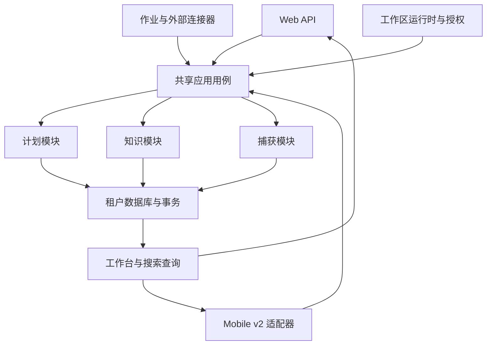

# 通用个人工作台后端重构方案

日期：2026-11-19
状态：第一批指定范围已实施，其余方案继续分批推进

### 第一批完成记录

已实现任务、Mobile v2 与新增工作台查询的共同运行时解析边界，以及严格的已认证工作区上下文。新增首页聚合、任务视图计数、项目列表摘要和项目概览接口；实现与字段说明见 [第一批接口文档](../../personal-workspace-backend-api.md)。

计划指标与有限列表在同一租户只读快照内聚合，校验 v2 状态及 epoch。最近笔记通过明确的 `platform_compatibility` 适配器保持现有权威源，失败时返回局部不可用状态。没有业务数据迁移或二次 cutover。

本批完成的是 P1 的共享解析基础和 P2 的首页/项目查询链路。全量启动装配整理、所有内容/作业入口迁移、v2 全局搜索、分页执行列表、捕获转换和复盘新接口仍属于后续批次。生产数据来源清点与规范本机运行环境验证也不能由隔离契约测试替代。

## 1. 目标与总体决定

把 FlowSpace 后端整理成支撑个人工作、学习、知识积累和生活计划的统一工作台：输入能够被可靠保存，计划能够落到具体行动，执行能够被回顾，相关资料能够被找回。

采用现有 Go/Gin 技术栈内的**模块化单体**。模块明确拥有自己的数据和业务规则，HTTP、mobile-v2、外部同步和后台作业共享应用用例。保留现有 v2 任务领域与控制库/租户库边界，分阶段替换外围旧路径。

本轮主要改善：

1. 同一工作区经 Web、手机或后台作业访问时，解析到相同的数据源和业务规则。
2. 首页、任务列表、项目、日历、搜索和复盘使用明确一致的统计与查询语义。
3. 原始捕获、可执行任务、笔记和外部资料之间的整理与关联有清楚的流程。
4. 增加新内容来源或项目模板时，核心任务状态机和启动流程保持稳定。
5. 每个迁移批次可以单独验证和发布，保留已有客户端的协议与数据身份。

默认按个人工作台设计，继续保留已有账号、工作区、成员授权和隔离能力。现阶段采用同一应用部署单元及现有 SQL、对象存储和持久化作业机制；模块划分不要求新增消息中间件、独立搜索集群或动态插件平台。

## 2. 当前代码调查

以下结论来自本地源码和已有设计文档，没有查询生产数据库，也没有以旧文档推断当前线上状态。

| 现状 | 已核对的证据 | 对本次方案的影响 |
| --- | --- | --- |
| 任务 v2 已有独立领域、状态机、版本与写入保护 | `backend/internal/taskdomain/architecture_test.go`、`repository.go`、`service.go` | 延续核心实现，把外围模块接到同样清楚的边界 |
| Web 内容接口和部分 worker 使用默认 Store，mobile-v2 内容命令解析租户运行时 | `backend/internal/router/router.go`、`backend/cmd/server/main.go`、`backend/internal/mobilev2service/content_commands.go` | 先核对并统一工作区数据源解析；尚不能据此断言线上已发生数据分叉 |
| 通用 Store 同时提供认证、任务、笔记、日程、搜索和同步 | `backend/internal/storage/store.go` | 逐模块收窄接口，业务层通过明确用例协作 |
| 部分同步代码通过 goroutine ID 隐式选择 Store | `backend/internal/repository/facade.go`、`backend/internal/service/no_global_repository_test.go` | 改为显式依赖和工作区上下文，逐步去掉这条临时兼容路径 |
| mobile-v2 服务包含内容业务 SQL，并依赖 HTTP handler 的类型 | `backend/internal/mobilev2service/commands.go`、`content_commands.go`、`service.go` | 将业务下沉到共享应用层，协议类型归协议包 |
| 首页通过多个完整列表计算数量和项目进度 | `frontend/src/routes/DashboardV2.tsx`、`frontend/src/components/personalWorkspace/WorkspaceOverview.tsx` | 补充首页聚合、轻量 facets、项目摘要和分页执行列表 |
| 已有 v2 设计其实已要求 facets 和完整 occurrence read model | `docs/superpowers/specs/2026-07-21-project-task-schedule-domain-redesign.md` | 补齐这部分原设计，而不是重新定义 v2 领域 |
| 全局搜索仍查询旧任务/日程表或对应索引 | `backend/internal/storage/sqlite/search.go`、`backend/internal/storage/postgres/search.go` | 搜索数据源改为规范 v2 实体，索引能够重建 |
| SQLite 搜索先按类型固定预取，再在内存中分页 | `backend/internal/storage/sqlite/search.go` | 新查询必须有跨类型稳定排序和正确的深分页 |
| v2 总结在兼容 handler 内统计、逐项目查询和内存分页 | `backend/internal/handler/task_domain_legacy_web_compat.go` | 提取查询用例；现有 `/today`、`/summary` 已有 v2 适配，继续兼容 |
| 笔记关联项目仍读取旧项目镜像 | `backend/internal/storage/sqlite/notes.go` | 统一项目身份和名称来源；迁移时清点旧关联与 v2 ID 映射 |
| 跨类型 inbox、系统任务收件箱和 mobile inbox 命令同时存在 | `backend/internal/service/inbox.go`、`frontend/src/hooks/useTaskInbox.ts`、`backend/internal/mobilev2service/content_commands.go` | 先统一语义和整理用例，再迁移存储 |
| 路线图限制为 learning 项目，日语 tokenizer 在主服务启动时强制预热 | `backend/internal/taskdomain/roadmap_service.go`、`backend/cmd/server/main.go` | 路线图改为项目可选能力，日语处理作为独立可选能力初始化 |

## 3. 核心业务模型

### 3.1 工作区与计划

沿用已有主链路：

```text
Workspace
  └─ Project                 一个目标或一组相关事务
       ├─ Task               要持续维护的任务定义
       │    ├─ Schedule      计划与重复规则的版本
       │    └─ Occurrence    某一次实际执行
       └─ Roadmap            可选的结构化计划
```

- 每个任务属于一个项目；明确是任务但暂未归类时进入系统收件箱项目。
- 单次任务和重复任务继续共用执行实例模型。
- 日历展示执行实例的时间投影。手动创建日程通过创建带时间安排的任务实现。
- 完成一次重复执行不等于完成整个任务；结束重复任务、取消未来安排和完成某次执行是不同命令。
- 项目进度分别返回任务完成数、开放执行数、阻塞执行数、下一次执行及是否存在无限期重复任务。只有分母明确时才展示百分比。
- 路线图节点描述结构、依赖与资料，实际执行由 Task/Occurrence 承担。
- 现有 `kind=learning` 继续兼容；通用路线图通过项目能力启用，学习作为模板和可选规则保留。旧客户端不能理解该能力时，不向其暴露不可操作的入口。

### 3.2 捕获与任务收件箱

区分两类事实：

| 对象 | 含义 | 后续处理 |
| --- | --- | --- |
| Capture item | 尚未判断用途的文字、链接、语音或资料输入 | 整理成笔记或任务，或归档 |
| 系统收件箱项目中的 Task | 已经明确要执行，但尚未归属正式项目的任务 | 选择项目、安排执行、正常完成 |

它们可以在同一个整理入口按类型呈现，但不会互相复制成两份业务对象。已明确的任务直接进入任务体系；原始素材不会被强制转成任务。

沿用现有 inbox 内容及移动端协议作为迁移起点。捕获项逐步补齐来源、处理状态、关联目标和 revision；采用可迁移的明确字段，不引入任意实体定义引擎。

整理流程：

```text
收到输入 → 待整理
            ├─ 转成任务 → 创建 v2 Task + Schedule + Occurrence
            ├─ 转成笔记 → 创建 Note，保留来源和附件
            └─ 归档
```

转换必须幂等，同一个捕获项重复提交返回同一个目标。通过 `expected_capture_revision` 和 `(workspace_id, capture_id)` 成功转换记录的唯一约束，保证不同幂等键、不同客户端或不同目标的并发请求也只能成功一次。完全相同的转换重放返回原目标，不同转换意图返回 409。目标创建、源状态更新、转换记录与变更事件在同一租户事务中提交。已转化项记录目标类型、ID 和处理时间。用户没有指定日期时保留未安排；旧转换中自动生成“明天 9 点”的行为退出新用例。

### 3.3 知识内容与关联

知识模块拥有笔记、目录、标签、附件元数据和来源信息。导入、语音转写、手工记录和外部同步最终调用相同的内容用例。

- 项目关联引用规范 v2 项目身份，展示名称从规范项目查询端口获取。
- 任务专属笔记与普通关联笔记保持各自语义，执行日志可以引用笔记作为结果或依据。
- 笔记可以关联多个项目；删除一个关联项目不能隐式删除被其他项目引用的笔记。
- Task、Note、Attachment、Capture 使用明确实体和各自版本规则。共用 `EntityRef{workspace_id, type, id}` 作为引用格式，不把所有数据塞进一个通用表。
- 重要业务关系优先采用有完整性约束的类型化关系表。通用引用只用于活动、搜索结果、来源等跨类型展示。
- 归档、可恢复删除、永久删除沿用各自命令与保留策略。业务删除、关联处理、同步 tombstone 和待清理对象记录一起提交；实际对象清理由后台完成。

## 4. 模块职责和依赖

| 模块 | 拥有的职责 | 对外协作边界 |
| --- | --- | --- |
| Identity / Workspace | 账号、会话、成员授权、工作区能力、数据源与服务绑定 | 输出经验证的身份、权限和工作区运行时 |
| Planning | 项目、任务、计划版本、执行、依赖、完成条件和路线图 | 提供业务命令及规范查询端口 |
| Knowledge | 笔记、目录、标签、附件元数据、来源和内容关联 | 提供内容命令、引用与读取端口 |
| Capture | 原始输入、待整理状态和转化记录 | 通过应用协调器调用计划与知识用例 |
| Workspace queries | 首页、项目摘要、活动、复盘、日历组合视图 | 只读组合模块查询，不维护第二套完成状态 |
| Search | 检索文档、索引、水位与查询 | 消费规范实体变化，返回可定位实体引用 |
| Integrations | Notion、Obsidian、播客来源、AI、转写等连接器 | 调用应用命令，输出明确结果和错误 |
| Jobs | 作业运行、租约、超时、重试、取消、失败记录和监控 | 承载各模块自己的作业状态机 |

HTTP 和 mobile-v2 属于传输适配层。它们解析参数、验证协议并映射结果；领域规则不放在 Gin handler 或同步协议包内。模块之间不直接写对方的数据表。



## 5. 工作区上下文和事务

### 5.1 所有入口使用相同解析规则

应用入口接收经过授权的 `WorkspaceContext`，包含 actor、workspace、权限、运行时 epoch 与必要的请求/命令标识。客户端提交的 workspace ID 不能直接当作授权结果。

- 身份、会话、成员资格、服务配置及加密凭据继续归控制库。
- 项目、任务、笔记、捕获及业务关联归工作区租户数据源。
- 请求与后台作业都通过相同的 WorkspaceResolver 获取当前运行时；绑定改变或 epoch 过期时失效并按现有规则重新验证。
- 运行时解析失败、切换未完成或租户不可写时返回明确错误，不选择默认数据库或重新打开 legacy 写入。
- 将大而全的 Store 逐步拆成模块需要的窄端口。迁移期可用 adapter 包装现有实现。

统一解析规则分为“统一入口”和“切换权威数据源”两步。若 P0 发现笔记、作业与目标租户数据源不同，P1 使用明确标记来源的模块兼容 adapter 保持已有权威源；完成内容回填、冲突处理和对账后，才按模块切换。更换 resolver 本身不能让已有数据消失或把后续写入导向另一份空数据库。

### 5.2 单次业务写入的提交边界

统一命令分派与事务宿主，但每个业务用例保留明确类型和处理器。

```text
验证身份与协议
  → 解析当前工作区运行时
  → 开启带 epoch 保护的租户事务
  → 检查幂等记录与预期 revision
  → 执行业务用例
  → 提交业务数据、必要关联、租户业务审计及可靠待办事件
  → 返回新版本与明确结果
```

**mobile-v2 的原子边界必须保持：** 命令账本准备、依赖检查、业务效果、终态收据、after-images 和 change batch 在同一个租户事务内完成。协议适配器可以提供已开启的受限事务能力给共享应用用例；用例不再开启嵌套事务。

账号、权限与管理审计仍在控制库事务中处理。需要跨库传播的派生记录通过可靠事件及幂等消费完成，不承诺控制库与租户库一起原子提交。

Web 新增的创建、转化和其他可重试写操作支持稳定的幂等键。同一键与同一请求重放返回原结果；同键不同请求返回冲突。已有移动端账本键、receipt 和 cursor 的 wire format 保持兼容，不重新解释其身份范围。

所有乐观版本冲突返回可识别错误与当前版本；重新提交需要调用方明确选择，不能静默覆盖。时间和命令 ID 由应用边界控制，延续现有审计规则。

### 5.3 外部调用和后台作业

- 在事务内持久化作业意图或 outbox；提交后再访问 Notion、AI、对象存储和转写服务。
- Worker 领取带租约的作业，执行外部 I/O，再以短事务和版本检查提交结果。租约丢失的 worker 不能覆盖后续处理者。
- 外部调用采用可重试、可能重复执行的模型，以来源标识、请求哈希或业务键保证结果落库幂等；不宣称第三方副作用恰好发生一次。
- 共用 runner、心跳、退避、超时、取消与失败观测。周期生成、导入、转写、同步和清理保留自己的持久状态与恢复规则。
- 周期生成继续遵守现有工作区 epoch、generation claim 和 watermark；不能用普通重试队列替代这套安全约束。
- 长同步逐步采用“提交 → 作业 ID → 查询进度”。旧同步端点在兼容期按原协议适配；异步协议只在客户端支持后切换。
- 日语注音等专用能力独立注册和初始化，能力不可用时影响该功能；核心任务和笔记仍可启动。

附件上传单独采用上传会话：先在 SQL 事务外流式保存请求字节到受限临时对象，再校验大小、类型及校验和，以短 fenced 事务确认附件元数据与业务关联。需要搬移或后处理的对象先标记为待完成，处理成功后才能暴露可用状态。失败、中断或超时会话由作业清理孤立对象，清理前核对其仍未被已提交附件引用。作业记录不能替代上传字节的持久化。

## 6. 查询与接口设计

下面是拟新增或补齐的 Web 契约，具体 DTO 和 OpenAPI 在对应实施批次固定。现有 `/api/mobile/v2/*` 保持协议兼容。

| 接口 | 用途与返回重点 |
| --- | --- |
| `GET /api/workspace/overview?date=&timezone=` | 首页：轻量指标、有限今日执行、项目摘要、最近笔记、待整理数量及各区域可用状态 |
| `GET /api/task-workbench/facets?project_id=&date=&timezone=` | 各任务视图的计数，避免下载完整列表计算数字 |
| `GET /api/task-occurrences?...&cursor=&limit=` | 当前视图的分页执行列表，直接带标题、项目、时间摘要及所需 revisions |
| `GET /api/projects?include=summary&...` | 项目列表与明确口径的进度摘要 |
| `GET /api/projects/:id/overview` | 项目概览与关键统计；详情各分区按需查询 |
| `GET /api/search?...&types=&cursor=&limit=` | 工作区范围内跨类型检索，规范实体引用与稳定排序 |
| `GET /api/reviews?from=&to=&timezone=` | 完成执行、阻塞、未完成、内容产出与相关笔记；旧 `/summary` 转换此结果 |
| `POST /api/captures` | 保存尚未确定用途的输入，记录来源和幂等键 |
| `POST /api/captures/:id/convert` | 明确转为任务或笔记，返回目标引用，重试不重复创建 |
| `GET /api/jobs/:id` | 作业进度、失败原因、重试或取消能力 |

分页新契约通过显式读模型/契约参数和 `limit` 协商，后续页再携带 `cursor`；首次请求也必须能与旧请求区分。旧 `page/page_size` 调用继续返回原 DTO 和原分页语义，不能因新增默认 limit 静默截断。新的实体引用通过字段追加或 DTO 映射兼容，客户端迁移后再收紧默认限制。URL 不等于业务模型版本，新增聚合接口不需要重新切换 workspace 的 task model。

### 6.1 首页与统计

- 先用同租户规范表的 SQL 查询和批量读取实现；仅在实际压力证明需要时增加物化读模型。
- 当前列表只获取当前筛选，计数由 facets 返回；不再拉取全部任务后在客户端拼标题或计算进度。
- 新查询契约的日期输入必须包含有效 IANA timezone；区间采用 `[from, to)`。全天日期、精确时间、计划时间与截止时间保留不同语义。旧 `/summary` 仍保留省略 timezone 时默认 Asia/Shanghai、`to` 日期包含当天的调用约定，由兼容层转换成新查询的排他上界。
- 今日、当前周、已完成等统计明确范围及是否包含 skipped/cancelled；不同视图不能共享一个含义模糊的 `completed` 数字。
- 同一响应的核心统计与执行列表使用一致的读取边界；如果来自异步投影，返回各自 `as_of` 或水位，不能伪称来自同一事务快照。
- 工作区、授权和核心计划模块不可用时返回对应错误。最近笔记或外部扩展不可用时可返回局部失败，不能把缺失内容伪装成 0 或空列表。

### 6.2 搜索与复盘

- 搜索规范 v2 项目、任务和知识内容；执行实例按需展开，避免一项重复任务产生大量相同搜索结果。
- 使用现有 SQL 存储适配器提供检索能力；索引为派生数据，可按 workspace 重建。
- 稳定排序包含最终唯一键；游标携带查询范围与排序信息，不使用“每类固定取三页再合并”的分页方式。
- 索引更新失败有持久重试记录；删除和权限变更在返回结果时仍受规范数据与授权过滤保护。
- 复盘的完成数来自实际完成执行；任务定义完成与一次重复执行完成分别表达。旧 `/summary` 适配器只映射原协议支持的已完成事项，维持原有 total、分组及分页口径，不将新增笔记产出或其他回顾条目混入旧完成数。AI 文本作为可再生成的摘要，不作为事实来源。

## 7. 代码组织目标

这是逐步演进的目标，不要求第一批搬动所有目录。

```text
backend/
  cmd/server/                  启动入口
  cmd/flowspace-admin/          显式迁移与运维入口
  internal/
    bootstrap/                 依赖装配与生命周期
    platform/
      identity/                控制库身份与授权
      workspace/               运行时、绑定、epoch 与能力
      credentials/             凭据与配置版本
    modules/
      planning/                domain / application / ports
      knowledge/               domain / application / ports
      capture/                 domain / application / ports
      workspacequery/          overview / facets / reviews
      search/                  文档投影与查询
    transport/
      http/                    Web 参数与 DTO
      mobilev2/                现有同步协议适配
      compatibility/           旧客户端翻译
    integrations/              Notion / Obsidian / AI / 来源
    jobs/                      共用 runner 与模块处理器
    storage/
      sqlite/                  窄端口实现
      postgres/                同一业务契约实现
```

迁移期间保留 `taskdomain`、`taskapp` 等已稳定包名。先改依赖方向和调用链，完成一条路径后再进行必要的目录调整。通过架构测试限制 HTTP、原始 SQL、全局仓储进入领域模块。

## 8. 数据与客户端迁移

### 8.1 迁移前清点

制作“入口 → 应用用例 → 实际数据库 → 表 → 同步事件”的矩阵，覆盖 Web、mobile-v2、Watch、Notion、Obsidian、导入与 worker。读取真实工作区绑定后，核对默认平台数据与租户数据是否同源。

保留实体 ID、工作区复合身份、revision、计划历史、执行日志、同步收据、变更序列历史、cursor 协议、来源 claim 和 tombstone。存在冲突时输出确定性的冲突清单与修复规则；不能覆盖合并后再以行数相同作为成功证明。

已签发的 cursor 仍受 workspace、scope、协议/运行时 epoch 等绑定约束。迁移导致绑定或 epoch 改变时，可以按现有协议返回需要重新 snapshot 的结果；不复制或伪造 cursor 来延长其有效期。实施前验证客户端能正确完成 reset 和 snapshot 恢复。

### 8.2 每批迁移步骤

1. 增加新端口、adapter 和必要的新结构，记录版本及校验。
2. 以固定映射回填，校验关联、状态、版本、来源和删除记录。
3. 新旧读取做影子对照。业务写入始终保留单一权威路径；过渡期需要同步衍生数据时使用现有可靠事件机制。
4. 按工作区和模块切换调用链，记录路由使用情况与失败码。
5. 稳定观察且确认所有相关客户端已迁移后，再删除旧 adapter 和冗余存储。

笔记项目关联迁移必须处理历史 legacy 项目 ID 到规范 v2 项目 ID 的映射、缺失引用和同 ID 不同来源冲突；名称只是显示信息，不用名称匹配代替身份校验。

### 8.3 现有环境与协议边界

- 已 cutover 的 workspace 不重新执行任务 v2 cutover，不开启 legacy writes。回滚应用仍必须理解已写入的 v2 数据。
- 控制库与租户库保持分离；本地/test 沿用 AGENTS.md 指定的两个 SQLite 数据库，PostgreSQL provider 与契约测试继续覆盖。
- 请求解析运行时不执行 DDL。迁移仍由显式管理命令执行。
- mobile-v2 snapshot、change、receipt、作用域、tombstone 和协议版本矩阵继续受现有契约约束。
- 当前 checkout 缺少标准测试数据库与密钥文件。集成验收前恢复规范测试环境并确认原有 cutover 状态；界面 fixture 的通过不代替真实认证与存储验证。

## 9. 实施批次

| 批次 | 交付 | 完成条件 |
| --- | --- | --- |
| P0：基线与契约 | 入口/数据源矩阵、行为清单、迁移检查项、规范测试环境 | 能准确定位每个入口的数据源；Web/mobile 同操作与隔离基线固定 |
| P1：装配与运行时 | 清晰 App 依赖和生命周期；统一 WorkspaceResolver；窄端口 adapter | 业务规则和现有响应保持兼容；笔记/作业经统一入口解析，未完成数据迁移的模块保持原权威源 |
| P2：工作台查询 | overview、facets、项目摘要、分页执行查询、v2 搜索、复盘用例 | 首页不再以多份完整列表计算指标；搜索覆盖新 v2 对象且深分页正确 |
| P3：内容与捕获用例 | Web/mobile 共用笔记与附件命令；规范项目关联；幂等捕获转化 | 相同输入只产生一份结果，关联项目改名一致，删除/重试/同步保持正确 |
| P4：连接器与通用能力 | 共用作业 runner；持久化长同步；可选路线图和专用能力 | 重启可续跑，租约丢失不越权提交；专用能力故障不阻断工作台 |
| P5：兼容收尾 | 旧 handler 仅映射协议；移除 goroutine scoped Store 和已退役读写路径 | 兼容流量及客户端清单证实可清理；线上观察与回滚演练通过 |

P2 的只读工作可以在 P1 的端口稳定后先行，但必须使用 P0 确认的权威数据源。P3 是写路径风险较高的批次，按笔记、附件、捕获逐条推进，保持 mobile-v2 原子事务。

**建议第一批实际开发范围为 P0、P1 和 P2 的首页查询链路**：先统一工作区解析与查询语义，让上一轮前端工作台拥有稳定的后台支撑，然后推进内容写入与集成收口。

## 10. 验收标准

### 业务一致性

- 在 Web 创建、改名、完成和删除任务后，首页、项目、日历、搜索与 mobile-v2 都呈现对应事实。
- 完成某次重复执行、改“仅本次”、改“本次及以后”、跳过和取消均保持现有状态与版本规则。
- 捕获转化重放不创建重复任务/笔记，事务失败不留下半转化状态。
- 项目改名后笔记关联和搜索名称一致；项目删除遵循明确的任务与内容处置规则，不产生孤立任务或误删共享笔记。

### 并发、隔离与协议

- 不同 workspace 即使使用同一个实体 ID，读取、搜索、附件、作业和变更流也不能串数据。
- 两个客户端并发写入能得到正确 revision 冲突；过期 epoch 无法写入。
- mobile 命令重复、依赖未完成、事务中断与重试保持原 receipt/change 语义；业务已提交但收据缺失的半成功状态不能产生。
- Watch token 的权限范围保持受限，统一入口不扩大其可访问能力。

### 查询与性能

- 搜索测试包含单类和跨类型超过三页结果，连续翻页不因固定预取上限提前结束。
- 首页计数与列表使用明确日期/时区；覆盖跨午夜、跨周、跨月和夏令时边界。
- 以 P0 记录的代表性数据规模建立首页、搜索和项目概览基线，再固定延迟与资源预算；不以空数据库的响应时间验收。
- 最近笔记等区域失败时返回局部可识别状态；核心权限或数据源失败保持明确错误。

### 作业与运维

- 导入、同步、转写和清理覆盖崩溃恢复、重复执行、取消、重试和租约过期。
- 运行观测至少能关联 request/command、workspace、模块和 job，并记录兼容流量、队列积压、失败率和投影水位。
- liveness、核心依赖 readiness 与工作区 capability/readiness 分开；健康状态能解释哪个依赖不可用。
- 沿用现有 CI 的后端格式、vet、单测、race、SQLite/PostgreSQL 契约与迁移、对象存储及 OpenAPI 检查；明确补充 mobile-v2 的显式契约目标。
- 前端接入新契约时运行 `npm run test:regression`，继续覆盖桌面 Chrome、Android Chrome、iPhone WebKit。

## 11. 方案的取舍

这次重构的主要成本在于统一数据源、内容写入事务和旧客户端兼容。目录拆分只是这些边界落地后的结果。

采用有限数量的稳定模块、明确命令与可重建查询投影，延续现有 v2 的安全机制。项目分类、模板和可选能力提供通用性；后续确有产品需求时，再独立设计领域分组、自定义字段、自动化规则或多人协作。
